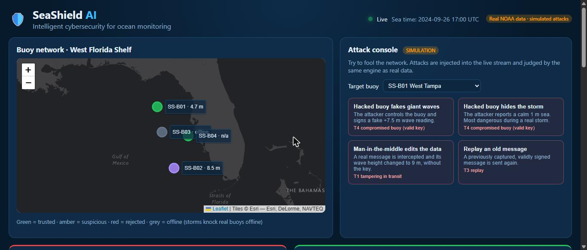
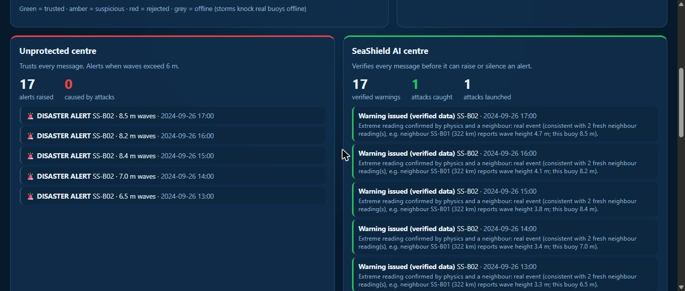
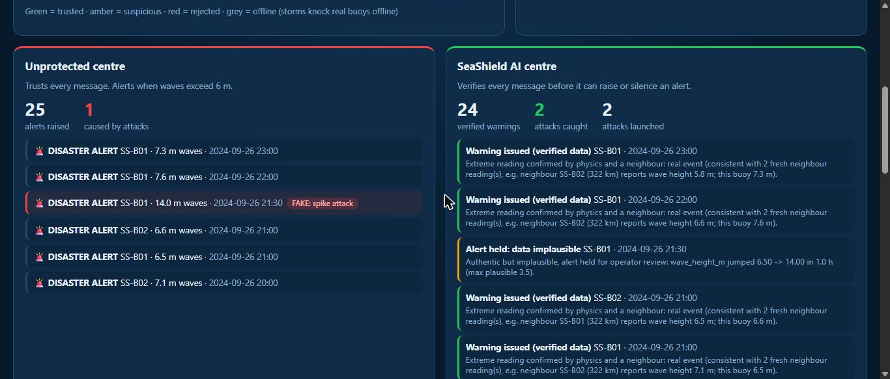
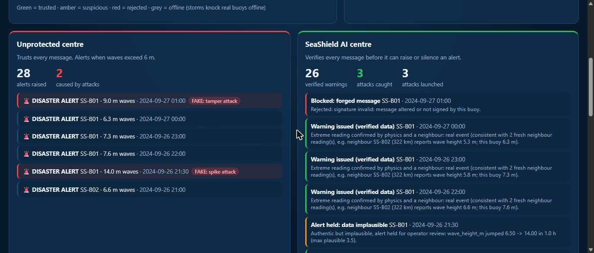
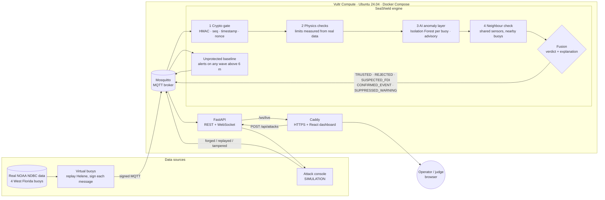

# SeaShield AI

A trust engine that checks ocean-buoy data before it can raise, or hide, a maritime warning.

**Live demo:** https://45-76-249-39.sslip.io (running on a Vultr Compute instance) ·
**API docs:** https://45-76-249-39.sslip.io/api/docs

HackGlobal 2026 · Track: **Civic and real-world impact**

---

## The problem

Ocean buoys measure waves, wind and pressure and send them to disaster-warning centres. Those
centres act on what they receive: high waves on a buoy can trigger a coastal warning, port
closures or evacuations. Most of the pipeline trusts the data as it arrives.

If the data is false, two things can go wrong:

- **A fake alarm:** a hacked or spoofed buoy reports giant waves. Ports close, ships divert,
  people evacuate for nothing, and the next real warning is taken less seriously.
- **A hidden storm:** a hacked buoy reports a calm sea while a real storm passes. The warning
  is late or never sent. This is the failure that costs lives.

This kind of attack is called **False Data Injection (FDI)**. A signature alone does not stop
it: a buoy whose key has been stolen still signs its lies correctly.

## What SeaShield does

SeaShield sits between the buoys and the warning centre and judges every message before it can
affect an alert. It answers two questions:

1. **Is this message really from this buoy, unchanged and fresh?** (cryptography)
2. **Is what it says believable?** (physics, an AI anomaly model, and the buoy's neighbours)

Each message gets a verdict with a plain-language explanation. Suspicious alerts are **held
for a human operator**, not silently dropped, and a possibly hidden storm is **escalated**. No
data is ever deleted.

The live demo replays **real NOAA data from Hurricane Helene** (23 to 28 September 2024) from
four real buoys on the West Florida Shelf, and shows two warning centres side by side on the
same stream:

- an **unprotected centre** that alerts on any wave reading above 6 m, and
- the **SeaShield centre**, which alerts only on verified data.

You then attack the stream yourself and watch how each centre reacts.

## Try it in 60 seconds

Open **https://45-76-249-39.sslip.io**.

1. **Watch the network.** The map shows the four buoys. Every few seconds a new hour of real
   Helene data arrives; the wave chart and the live message feed update. During the storm
   both centres issue genuine high-wave alerts: real storms are not flagged as attacks.
2. **Pick a target buoy** in the *Attack console* (for example `SS-B01 West Tampa`).
3. **Hacked buoy fakes giant waves** (*spike*). The buoy signs a fake +7.5 m reading with its
   real key. The unprotected centre raises an alarm. SeaShield sees an impossible jump in
   one hour and **holds** the alert for an operator.
4. **Man-in-the-middle edits the data** (*tamper*). A real message is changed to 9 m in
   transit. The signature no longer matches: SeaShield **rejects** it and the alert is
   **blocked**. The unprotected centre alerts.
5. **Replay an old message** (*replay*). A valid, previously captured message is sent again.
   SeaShield rejects it (sequence number already used, or timestamp too old).
6. **Hacked buoy hides the storm** (*suppress*). Try it while Helene is at its peak: the buoy
   reports a calm 1 m sea. The unprotected centre goes quiet. SeaShield sees a drop no real
   sea makes in one hour and sends the reading to an operator for **review**, or **escalates**
   it when the neighbouring buoys still see the storm. (In calm weather the same attack is physically plausible
   and cannot be detected; see [Limitations](#limitations).)
7. Read the *Live message feed*: every message shows its verdict and a one-line explanation
   of why. *How SeaShield decides* at the bottom summarises the layers.

Fake values are drawn in red on the wave chart. Attacks are simulated and only affect the demo.

## Screenshots

| | |
|---|---|
|  |  |
| **Dashboard:** map, the two centres, attack console, wave chart, feed | **Hurricane Helene:** real 7–9 m waves, genuine alerts go out |
|  |  |
| **Spike attack:** fake giant waves, alert held for review | **Tamper attack:** edited in transit, rejected and blocked |

## Architecture



Every message carries a signed `ts` (send time, for replay protection) and a signed
`observed_at` (measurement time, for physics). The engine runs the same raw message through
the unprotected baseline and the SeaShield pipeline and publishes one event with both
decisions. More detail: [`docs/architecture.md`](docs/architecture.md) ·
threat model: [`docs/threat-model.md`](docs/threat-model.md).

## How it decides

| Layer | What it checks | Catches | Can it decide alone? |
|---|---|---|---|
| **1 Crypto gate** | Per-buoy HMAC signature on the raw message, increasing sequence number, timestamp within 120 s, unseen nonce | Tampering in transit, forged messages, replays | Yes: failure → `REJECTED` |
| **2 Physics checks** | Value ranges; per-hour change limits measured from real NOAA data (waves 3.5 m/h, wind 15 m/s/h, pressure 20 hPa/h, water temp 3 °C/h); measurement time must move forward | A hacked buoy (valid key) reporting impossible values or jumps | Yes: failure → `SUSPECTED_FDI` |
| **3 AI anomaly layer** | One Isolation Forest per buoy, trained on real 2023 data (incl. Hurricane Idalia); score 0..1 with the top two unusual features | Unusual combinations of readings | **No, advisory.** Shown in every explanation. Allowed to decide alone, it held 34 of 137 genuine Helene readings ([D6 report](docs/PHASE_D6.md)) |
| **4 Neighbour check** | Compares a buoy with nearby buoys on the sensors they share; a silent neighbour counts as "no opinion", never as calm | Confirms real storms seen by several buoys; flags a buoy reporting calm while its neighbours see a storm | Yes → `CONFIRMED_EVENT` or `SUPPRESSED_WARNING` ([details](docs/PHASE_5_SPATIAL.md)) |
| **Fusion** | Takes the strongest evidence, not an average, so one quiet layer cannot dilute an alarm | | Produces the verdict and explanation |

**Verdicts:** `TRUSTED` · `REJECTED` (crypto failure) · `SUSPECTED_FDI` (authentic but not
believable) · `CONFIRMED_EVENT` (a real event backed by neighbours) · `SUPPRESSED_WARNING`
(possible hidden danger).

**What the SeaShield centre does with them:** high waves on verified data → alert **issued**;
high waves on suspect data → alert **held** for an operator; high waves in a forged or replayed
message → **blocked**; a suspect calm reading → operator **review**; a possible hidden storm →
**escalated**.

## Results

Full evaluation: [`docs/evaluation.md`](docs/evaluation.md). Measured so far, on real data:

- **Physics rules: 0 false alarms on 94,458 real buoy-hours**, all four buoys, 2023–2025,
  including hurricanes Idalia, Debby, Helene and Milton ([Phase 1](docs/PHASE_1.md),
  [Phase 2](docs/PHASE_2.md)).
- **Live end-to-end test over MQTT:** 233 of 233 genuine messages (Helene + a calm week)
  judged `TRUSTED`, 13 correct baseline alerts during Helene ([Phase 2](docs/PHASE_2.md)).
- **Injected compromised-buoy fakes**, validation period Jan–Jun 2024, never used for training
  ([D6](docs/PHASE_D6.md)):

  | | Physics | AI (Isolation Forest) |
  |---|---|---|
  | False alarms on 17,428 real readings | 0 | 6 (0.03 %) |
  | Detected: +4 m / +7.5 m fakes | 76.8 % / 74.3 % | 1.4 % / 1.4 % |
  | Detected: +0.5 / +1 / +2 m fakes | 0 % | 0 % |

  The physics misses at +4/+7.5 are mostly the wind-only buoy (SS-B04), where the fake is
  added to wind. Small fakes are the job of the neighbour check.

All attacks are simulated on real historical data. No result here is a field validation.

## Run it yourself

Repository: https://github.com/tahabenissa/hackathon-sea

### 1. Setup (Python 3.12)

```bash
git clone https://github.com/tahabenissa/hackathon-sea.git && cd hackathon-sea
python -m venv .venv
source .venv/bin/activate                 # Windows: .venv\Scripts\activate
pip install -e ".[dev,ml]"
python infra/scripts/gen_buoy_keys.py     # per-buoy keys -> secrets/buoy_keys.json (git-ignored)

# Real NOAA data (~3 years, 4 stations) and the AI model
for st in 42036 42097 42099 42013; do python ml/download_ndbc.py $st 2023 2024 2025; done
python ml/clean.py 42036 42097 42099 42013  # -> data/processed/*.parquet
python ml/train.py                          # -> models/isolation_forest.joblib

pytest                                      # test suite
```

### 2. Full stack with Docker (same as the live demo)

```bash
cp .env.example .env                       # change the passwords
docker compose up -d --build               # mosquitto, engine, api, simulator, web
```

Open http://localhost. The simulator loops 23–28 September 2024 (one historical hour every
2 s, about 4 minutes per loop). API docs: http://localhost/api/docs.

### 3. Without Docker (dev)

```powershell
amqtt -c infra/dev/amqtt.yaml                                    # 1. local MQTT broker
$env:SEASHIELD_MQTT_HOST="localhost"; python -m seashield.engine  # 2. engine
$env:SEASHIELD_MQTT_HOST="localhost"; uvicorn seashield.api.main:app --reload   # 3. API
$env:SEASHIELD_MQTT_HOST="localhost"                              # 4. replay Helene
python -m seashield.simulator --start 2024-09-23T00:00 --end 2024-09-28T00:00 --interval 2 --loop
cd dashboard; npm install; npm run dev                            # 5. http://localhost:5173
```

### 4. Deploy to Vultr (one command)

On a fresh Vultr Compute instance (Ubuntu 24.04; the demo uses 2 vCPU / 4 GB) with your SSH
key, from the repo root after step 1:

```bash
bash infra/scripts/deploy_vultr.sh <server-ip> [domain]
```

The script ships the committed code, the processed data and the model, installs Docker, opens
only ports 22/80/443, generates the buoy keys and `.env` **on the server** (secrets never
leave it) and starts the stack. Without a domain it uses `<ip-with-dashes>.sslip.io`, and
Caddy obtains an HTTPS certificate automatically.

## Data

- **Source:** NOAA National Data Buoy Center (NDBC) standard meteorological history, hourly,
  2023–2025.
- **Network** (`config/buoys.yaml`), West Florida Shelf, eastern Gulf of Mexico. The network
  is mixed on purpose, as real networks are: not every buoy has every sensor.

  | ID | NDBC station | Sensors |
  |---|---|---|
  | SS-B01 | 42036 West Tampa | waves, period, wind, pressure, water temp |
  | SS-B02 | 42097 Pulley Ridge | waves, period, water temp |
  | SS-B03 | 42099 Offshore St. Petersburg | waves, period, water temp |
  | SS-B04 | 42013 WFS Central C10 | wind, pressure, water temp |

- **Time split, no shuffling:** train 2023 (Hurricane Idalia) · validation Jan–Jun 2024 ·
  test Jul 2024–Dec 2025 (Debby, Helene, Milton), never used for tuning.
- Cleaning rules, outages and neighbour statistics: [`docs/data-notes.md`](docs/data-notes.md).
  One finding that shaped the design: storms knock buoys offline, so a silent neighbour is
  never treated as evidence of calm.

## Limitations

- **Attacks are simulated** on real historical data. Nothing here has been tested on a live
  buoy network.
- **Hiding a storm in calm weather cannot be detected.** A buoy reporting 1 m when the real
  sea is 1.5 m is physically plausible and agrees with its neighbours. Suppression is caught
  only when it contradicts the physics or the neighbours, i.e. during a real event.
- **Small fakes (about 2 m or less)** pass physics and the AI layer; only the neighbour check
  can catch them, and only on buoys that share a sensor with a nearby buoy.
- **The AI layer is advisory.** The Isolation Forest flags real hurricanes as unusual, because
  Helene was stronger than anything in its training year.
- **No persistence in the demo.** Events live in memory and in the browser; PostgreSQL is in
  the compose file (profile `db`) but not wired in.
- **The MQTT broker is local to the server.** TLS and per-buoy credentials for remote buoys
  (`infra/mosquitto/mosquitto.prod.conf`) are future work.
- A stolen key is only detected by what the data says, not by the crypto layer.

## Roadmap

1. Wire in PostgreSQL: store every message, verdict and operator decision for audit.
2. MQTT over TLS with per-buoy credentials, so real remote buoys can connect.
3. A residual AI model: predict each reading from the buoy's own history, its other sensors
   and its neighbours, trained on multi-year data that includes hurricanes, and flag large
   surprises.
4. Operator workflow: accept or overrule held alerts, with a reason, from the dashboard.
5. Complete the test-period evaluation (2024-07 → 2025-12) and publish it in
   [`docs/evaluation.md`](docs/evaluation.md).
6. More regions and more buoys per region, so every buoy has a neighbour on every sensor.

## Track fit: Civic and real-world impact

Coastal warning systems are public infrastructure. Their value depends on people trusting
them: a warning that turns out to be fake teaches people to ignore the next one, and a warning
that never comes is worse. SeaShield works as a misinformation check for ocean sensors. It is
built and measured on real public NOAA data from real hurricanes, it explains every decision
in plain language, and it keeps a human in charge of every held alert instead of deleting
data or deciding alone.

## Project layout

```
seashield/            Python package (one Docker image, several services)
  common/             message schema, HMAC signing, buoy registry, MQTT helper
  simulator/          virtual buoys replaying NOAA data as signed MQTT messages
  attacker/           SIMULATED attack scenarios (demo + evaluation)
  engine/             crypto_gate, physics, anomaly (AI), spatial (neighbours), fusion, baseline
  api/                FastAPI REST + WebSocket, live hub, attack endpoints
ml/                   download, clean, explore, train, evaluate
dashboard/            React + Vite + Leaflet + Recharts (served by Caddy)
infra/                mosquitto, caddy, postgres schema, setup and deploy scripts
config/buoys.yaml     buoy network definition
tests/                pytest suite
docs/                 architecture, threat model, decisions, phase reports, evaluation
```

Design notes: [`SEASHIELD_AI_MASTER_PROMPT.md`](SEASHIELD_AI_MASTER_PROMPT.md) ·
plan: [`docs/PLAN.md`](docs/PLAN.md) · decisions: [`docs/decisions/`](docs/decisions/).
