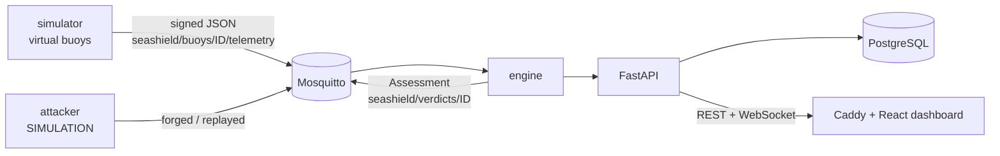

# Architecture

## Message lifecycle

1. `simulator` reads the next NOAA reading, builds `{buoy_id, seq, ts, nonce, data}`, signs it
   (`seashield/common/signing.py`), publishes to `seashield/buoys/<id>/telemetry`.
2. `engine` receives it and feeds **the same raw message** into two pipelines:
   - `baseline.naive_alert`: the unprotected centre (threshold only)
   - `pipeline.SecurityPipeline`: crypto gate → physics → anomaly → spatial → fusion
3. The `Assessment` (verdict, risk, per-layer evidence, explanation) is published to
   `seashield/verdicts/<id>` and stored (Phase 7).
4. `api` pushes it to the dashboard over `/ws/live`.

## Services (docker-compose.yml)

| Service | Image | Ports (public) |
|---|---|---|
| mosquitto | eclipse-mosquitto:2 | none in dev · 8883 TLS in prod |
| postgres | postgres:16 | none |
| api | ./Dockerfile | via Caddy `/api`, `/ws` |
| engine | ./Dockerfile | none |
| simulator | ./Dockerfile | none |
| attacker | ./Dockerfile (profile `demo`) | none |
| web | dashboard/Dockerfile (Caddy) | 80, 443 |

Design decisions are recorded in [`decisions/`](decisions/).
