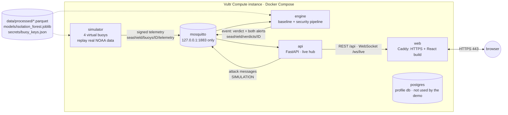
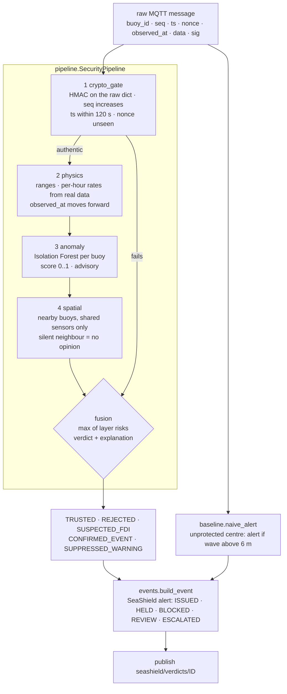
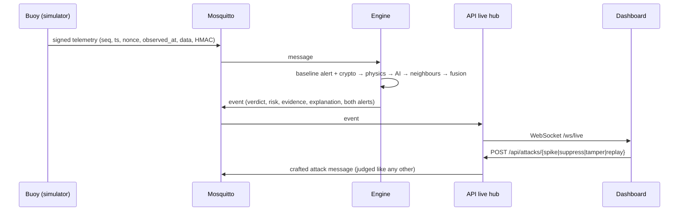

# Architecture

SeaShield AI runs as one Docker Compose stack on a single Vultr Compute instance
(Ubuntu 24.04, 2 vCPU / 4 GB, Atlanta). Live: https://45-76-249-39.sslip.io

## System overview

Only ports 22, 80 and 443 are open (ufw). The broker listens on localhost only; the attack
console reaches it through the API, which rate-limits attacks (one every 2 s).

## Inside the engine

- **Crypto proves origin and integrity, not truth.** A buoy with a stolen key passes layer 1;
  layers 2 to 4 judge whether what it says is believable.
- **History advances only on accepted readings**, so an attacker cannot poison the reference
  used for the next physics or AI check.
- **The AI layer is advisory** (`fusion.AI_DECIDES = False`): its score and reasons appear in
  the explanation, but it cannot hold an alert alone. Measured reason: allowed to decide, it
  held 34 of 137 genuine Hurricane Helene readings ([PHASE_D6.md](PHASE_D6.md)).
- **Neighbour check** ([PHASE_5_SPATIAL.md](PHASE_5_SPATIAL.md)): compares a buoy with nearby
  buoys on the sensors they share. Agreement on a high reading gives `CONFIRMED_EVENT`; a calm
  reading while neighbours see a storm gives `SUPPRESSED_WARNING`.

## Verdict → alert decision

| Verdict | Meaning | SeaShield centre |
|---|---|---|
| `TRUSTED` | authentic and believable | alert **issued** if waves above 6 m |
| `CONFIRMED_EVENT` | real event, backed by neighbours | alert **issued** |
| `REJECTED` | crypto failure (forged, tampered, replayed) | high-wave alert **blocked** |
| `SUSPECTED_FDI` | authentic but not believable | high reading → **held** for an operator; low reading → operator **review** |
| `SUPPRESSED_WARNING` | possible hidden danger | **escalated** to the operator |

No message is deleted. The unprotected centre receives the same message and alerts on any
wave reading above 6 m.

## Message lifecycle

1. `simulator` reads the next real NOAA hour, builds the message, signs it
   (`seashield/common/signing.py`) and publishes to `seashield/buoys/<id>/telemetry`.
   `ts` is the send time (replay protection); `observed_at` is the measurement time (physics).
2. `engine` feeds **the same raw message** to the unprotected baseline and to the security
   pipeline, then publishes one event with both decisions to `seashield/verdicts/<id>`.
3. `api` keeps recent events in memory (`seashield/api/live.py`), serves `/api/events` and
   `/api/stats`, and pushes each event to the dashboard over `/ws/live`.
4. The attack console calls `POST /api/attacks/{scenario}`; the API builds the attack
   (`seashield/attacker/scenarios.py`) and publishes it on the buoy's topic.
5. An operator reset (`seashield/control/reset`, ACL user `operator` only) clears engine
   history when the replay loops back in time; replay protection is kept.

## Services (`docker-compose.yml`)

| Service | Image | Role | Public ports |
|---|---|---|---|
| mosquitto | eclipse-mosquitto:2 | MQTT broker | none (127.0.0.1:1883) |
| engine | ./Dockerfile | judges every message | none |
| api | ./Dockerfile | REST + WebSocket + attack console | via Caddy `/api`, `/ws` |
| simulator | ./Dockerfile | replays 2024-09-23 → 28 in a loop, 1 h every 2 s | none |
| web | dashboard/Dockerfile (Caddy) | HTTPS, static dashboard, reverse proxy | 80, 443 |
| postgres | postgres:16 (profile `db`) | persistence, not wired into the demo | none |

Future: `infra/mosquitto/mosquitto.prod.conf` (TLS on 8883 with per-buoy credentials) for
real remote buoys.

Design decisions are recorded in [`decisions/`](decisions/). Threat model:
[`threat-model.md`](threat-model.md).
