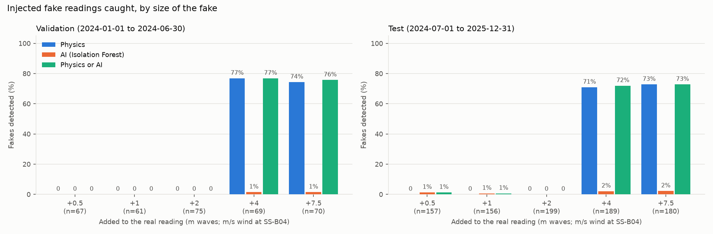

# Evaluation results

> Every number in this file comes from a real run on real NOAA NDBC buoy data. Nothing is
> estimated by hand. The attacks are **simulated** (injected into real historical readings);
> this is not a field trial against a real attacker.

## Summary (key numbers)

1. **Forged, tampered and replayed messages are rejected** by the crypto gate (HMAC + sequence +
   nonce + timestamp window), by construction and covered by unit tests.
2. **0 false alarms from physics** on real data: 0 of 17,428 readings (validation)
   and **0 of 44,024 (test, including 871 readings taken during hurricanes Debby, Helene and Milton)**.
   (The physics limits were set from the largest real changes over 2023–2025; see §9.)
3. **Large fake waves are caught**: on the 3 wave buoys, physics caught **100 %** of injected
   +4 m and +7.5 m fakes (validation 105/105, test 265/265). Over all 4 buoys, including the
   wind-only buoy where the fake is a wind change: 72.0 % (+4) and 72.8 % (+7.5) on test.
4. **Small fakes are not caught**: +0.5 m, +1 m and +2 m fakes are caught 0–1.3 % of the time
   by any layer. They are physically plausible for one buoy on its own.
5. **The AI layer is advisory only**: it caught ≤ 2.2 % of fakes of any size, and all 45 of its
   test false alarms fell **inside the hurricane windows** (45 of 871 storm readings, 5.2 %). Allowed
   to decide alone, it held **34 of 137** genuine Hurricane Helene readings. So it explains,
   but does not decide.

---

## 1. What is evaluated

SeaShield judges every buoy message with four layers:

| Layer | Question it answers | How it is evaluated here |
|---|---|---|
| 1. Crypto gate | Did this message really come from this buoy, unchanged and only once? | Unit tests (§6) |
| 2. Physics checks | Is the reading physically possible after the previous one? | Replay of real data + injected fakes (§3, §4) |
| 3. AI anomaly (Isolation Forest, one per buoy) | Is the reading unusual for this buoy? | Same replay (§3, §4), plus a hurricane replay (§5) |
| 4. Neighbour check | Do nearby buoys agree? | Evaluated separately in `docs/PHASE_5_SPATIAL.md` |

The hard case is threat **T4, a compromised buoy**: an attacker with the buoy's key sends
correctly signed, fresh messages with false values. Crypto cannot see this
(`test_compromised_buoy_passes_crypto`), so layers 2–4 must catch it. This evaluation measures
how well layers 2 and 3 do.

## 2. Method

Script: `ml/evaluate.py --part validation|test` → `docs/assets/eval/<part>.json`.

**Data.** Real hourly NOAA NDBC readings from 4 buoys on the West Florida Shelf
(SS-B01 = 42036, SS-B02 = 42097, SS-B03 = 42099, SS-B04 = 42013; see `docs/data-notes.md`).

**Time split, no shuffling.**

| Part | Period | Real events inside | Use |
|---|---|---|---|
| Train | 2023-01-01 → 2023-12-31 | Hurricane Idalia, Dec 2023 front | Fit the Isolation Forests and calibrate their scores |
| Validation | 2024-01-01 → 2024-06-30 | winter fronts only (no hurricane) | Numbers in §3 |
| Test | 2024-07-01 → 2025-12-31 | Debby, Helene, Milton | Final check only (§4), run once, never used for tuning |

**Replay.** For each buoy, the real readings of the period are fed in time order through the
physics layer and the AI layer, exactly as the live engine does. Only accepted readings become
the history for the next one.

**Injected attacks.** For a seeded random 2 % of real hours (`numpy` seed 42), a fake twin is
built from the genuine reading: the same values, plus **+0.5, +1, +2, +4 or +7.5** on the
attacked field (wave height in m for SS-B01..B03; wind speed in m/s for SS-B04, which has no
wave sensor). The fake is dated 30 minutes before the genuine reading, judged against the
**same history**, and **never committed**, so it cannot affect later readings.

**What is counted.**
- **False positive (FP):** a genuine reading that a layer flags.
- **Detection:** a fake that a layer flags. Physics flags = the check fails; AI flags =
  score ≥ 0.5 (0.5 = as rare as the rarest 0.1 % of real 2023 readings).
- **Either:** flagged by physics or AI.

## 3. Results on the validation part (Jan–Jun 2024)

Source: `docs/assets/eval/validation.json`.

### 3.1 False positives on genuine data

| Buoy | Genuine readings | Physics | AI | Either |
|---|---|---|---|---|
| SS-B01 (waves + wind + pressure) | 4,368 | 0 | 0 | 0 |
| SS-B02 (waves) | 4,368 | 0 | 0 | 0 |
| SS-B03 (waves) | 4,368 | 0 | 0 | 0 |
| SS-B04 (wind + pressure) | 4,324 | 0 | 6 | 6 |
| **Total** | **17,428** | **0 (0 %)** | **6 (0.034 %)** | **6 (0.034 %)** |

**Storm hours:** the validation half-year contains **0 hours** inside the named-storm windows
(Debby, Helene, Milton are all in the test part), so it says nothing about storms. Storm
behaviour is measured on the test part (§4) and in the Helene replay (§5).

### 3.2 Detection of injected fakes (all 4 buoys)

| Fake added | Fakes | Physics | AI | Either |
|---|---|---|---|---|
| +0.5 | 67 | 0 (0 %) | 0 (0 %) | 0 (0 %) |
| +1 | 61 | 0 (0 %) | 0 (0 %) | 0 (0 %) |
| +2 | 75 | 0 (0 %) | 0 (0 %) | 0 (0 %) |
| +4 | 69 | 53 (76.8 %) | 1 (1.4 %) | 53 (76.8 %) |
| +7.5 | 70 | 52 (74.3 %) | 1 (1.4 %) | 53 (75.7 %) |
| **All** | **342** | **105 (30.7 %)** | **2 (0.6 %)** | **106 (31.0 %)** |

### 3.3 Per buoy: why the total is not 100 % at +4 and +7.5

| Buoy (attacked field) | +4 caught by physics | +7.5 caught by physics | AI hits |
|---|---|---|---|
| SS-B01 (waves) | 14/14 | 16/16 | 0 |
| SS-B02 (waves) | 18/18 | 20/20 | 1 at +4 (also caught by physics) |
| SS-B03 (waves) | 21/21 | 16/16 | 0 |
| SS-B04 (**wind**, m/s) | **0/16** | **0/18** | 1 at +7.5 (missed by physics) |

- On the **wave buoys, physics catches every +4 m and +7.5 m fake** (105 of 105). The wave
  rate limit is 3.5 m per hour, set from the largest real hourly change in the data (2.905 m,
  SS-B03 during Idalia, train year) plus a margin. Any jump above it is flagged.
- All misses at +4 / +7.5 are on **SS-B04, where the fake is wind**. The wind rate limit is
  15 m/s per hour (largest real change: 11.8 m/s), so +4 and +7.5 m/s are within what real wind
  does. The only fake caught there was one +7.5 m/s case flagged by the AI.
- The 6 AI false alarms are all on SS-B04 as well.

## 4. Results on the test part (Jul 2024 – Dec 2025, hurricanes included)

Source: `docs/assets/eval/test.json`. Run **once** with `python ml/evaluate.py --part test`
(10 min 42 s), after the model, thresholds and the advisory decision were already fixed.
Nothing was changed after seeing these numbers.

### 4.1 False positives on genuine data, overall and during storms

Storm hours = readings inside the Debby (2024-08-02→06), Helene (2024-09-24→28) and Milton
(2024-10-07→11) windows.

| Buoy | Genuine readings | Physics | AI | Storm readings | Physics in storms | AI in storms |
|---|---|---|---|---|---|---|
| SS-B01 | 13,171 | 0 | 9 | 291 | 0 | 9 (3.1 %) |
| SS-B02 | 7,362 | 0 | 22 | 269 | 0 | 22 (8.2 %) |
| SS-B03 | 11,017 | 0 | 1 | 97 | 0 | 1 (1.0 %) |
| SS-B04 | 12,474 | 0 | 13 | 214 | 0 | 13 (6.1 %) |
| **Total** | **44,024** | **0 (0 %)** | **45 (0.10 %)** | **871** | **0 (0 %)** | **45 (5.2 %)** |

- **Physics: 0 false alarms, also through three hurricanes.**
- **Every one of the AI's 45 false alarms is a real storm reading**; outside the storm
  windows it raised none (0 of 43,153). This is the same failure seen in the Helene replay
  (§5): the AI flags *unusual* weather, and hurricanes are unusual.
- SS-B03 has only 97 storm readings because it was offline for Helene and Milton (real outage).

### 4.2 Detection of injected fakes (all 4 buoys)

| Fake added | Fakes | Physics | AI | Either |
|---|---|---|---|---|
| +0.5 | 157 | 0 (0 %) | 2 (1.3 %) | 2 (1.3 %) |
| +1 | 156 | 0 (0 %) | 1 (0.6 %) | 1 (0.6 %) |
| +2 | 199 | 0 (0 %) | 0 (0 %) | 0 (0 %) |
| +4 | 189 | 134 (70.9 %) | 4 (2.1 %) | 136 (72.0 %) |
| +7.5 | 180 | 131 (72.8 %) | 4 (2.2 %) | 131 (72.8 %) |
| **All** | **881** | **265 (30.1 %)** | **11 (1.2 %)** | **270 (30.6 %)** |

### 4.3 Per buoy

| Buoy (attacked field) | +4 caught by physics | +7.5 caught by physics | AI hits (all sizes) |
|---|---|---|---|
| SS-B01 (waves) | 53/53 | 52/52 | 0 |
| SS-B02 (waves) | 27/27 | 36/36 | 6 (1 at +1, 1 at +4, 4 at +7.5) |
| SS-B03 (waves) | 54/54 | 43/43 | 1 (at +4) |
| SS-B04 (**wind**, m/s) | **0/55** | **0/49** | 4 (2 at +0.5, 2 at +4) |

The test part confirms the validation picture: **every** +4 m and +7.5 m fake wave was caught
(265/265), wind fakes within the real wind rate are not caught by physics, and fakes of 2 m or
less pass. The few AI hits on small fakes (3 of 512) are too rare to rely on, and may be
coincidences rather than real detection: the same model flags 5.2 % of genuine storm readings.

## 5. The AI-advisory decision (measured, not assumed)

The Isolation Forest was trained only on real 2023 data. These measurements decided its role
(details in `docs/PHASE_D6.md`):

| Measurement | Result |
|---|---|
| Large fakes caught by AI (validation, +4 / +7.5) | 1/69 (1.4 %) and 1/70 (1.4 %) |
| AI false alarms (validation) | 6 of 17,428 genuine readings |
| Fakes caught by AI (test, all sizes) | 11 of 881 (1.2 %); +4 / +7.5: 4/189 (2.1 %) and 4/180 (2.2 %) |
| AI false alarms (test) | 45 of 44,024 genuine readings, **all 45 inside the hurricane windows** (45 of 871, 5.2 %) |
| Real Hurricane Helene replay (2024-09-25 12:00 → 09-27 12:00) **with the AI allowed to decide alone** | **34 of 137 genuine messages held as SUSPECTED_FDI** |
| Same replay with the AI advisory (`fusion.AI_DECIDES = False`) | **0 suspected, 0 rejected** (`tests/test_replay.py`) |

Helene (953.6 hPa, 8.76 m waves) was stronger than anything in the 2023 training year, so the
AI correctly found it *unusual*, but unusual is not the same as attacked. Holding real
hurricane warnings is the worst failure a warning system can have. So the AI score is computed
and **shown** with its reasons on every reading, but the decision rests on crypto + physics
(+ neighbours).

**Why the AI is weak at detection here:** an Isolation Forest isolates points by random splits
over all features. A fake that changes 1 feature out of 3–7 normal ones is diluted and scores
close to normal. Moving the alarm from the 2023 maximum to the 2023 p99.9 (training data only)
did not change detection.

## 6. Crypto gate (layer 1)

Forged, tampered and replayed messages fail by construction: the HMAC covers the whole
canonical message, the sequence number must increase, each nonce is used once, and the send
timestamp must be within a 120 s window. Tests in `tests/test_crypto_gate.py`:

| Test | Expected | Result |
|---|---|---|
| `test_valid_message_passes` | genuine signed message accepted | pass |
| `test_tampered_in_transit_rejected` | one changed value → bad signature | pass |
| `test_unknown_device_rejected` | unknown buoy ID / key → rejected | pass |
| `test_replay_rejected` | same message sent twice → rejected as replay | pass |
| `test_stale_timestamp_rejected` | message 10 min outside the 120 s window → rejected | pass |
| `test_compromised_buoy_passes_crypto` | fake values signed with a **stolen key** → accepted by crypto | pass (this is the T4 gap layers 2–4 cover) |

## 7. Other measured facts

- **Physics on all real data:** 0 of 94,458 real hours flagged (all 4 buoys, 2023–2025,
  including Idalia, Debby, Helene and Milton), while a 1.5 → 9.0 m hourly jump is caught
  (`docs/PHASE_2.md`).
- **Live end-to-end run** (broker, engine, simulator as separate processes): 233 of 233 genuine
  messages TRUSTED (137 during Helene + 96 in a calm week after a restart), 0 rejected,
  0 suspected; the unprotected baseline raised 13 correct high-wave alerts during Helene
  (`docs/PHASE_2.md`).

## 8. Interpretation

- **What SeaShield reliably stops:** anything forged, altered or replayed in transit (crypto),
  and a compromised buoy that jumps a wave reading by more than the physical limit (≈ 3.5 m in
  an hour). That is exactly the "fake 9 m wave in calm weather" attack that would trigger a
  false evacuation.
- **What it does not stop alone:** small fakes (+0.5 to +2 m waves, or wind changes within
  15 m/s per hour). These values are physically plausible for one buoy taken on its own, so
  no single-buoy check can separate them from real weather without also flagging real storms.
  We say so plainly rather than tune thresholds until the numbers look better.
- **The right tool for small fakes is the neighbour check.** Real neighbours agree closely:
  99 % of hourly wave differences between SS-B01 and SS-B03 (130 km apart) are ≤ 0.79 m
  (`docs/data-notes.md` §4). That layer is evaluated separately in `docs/PHASE_5_SPATIAL.md`.
- **Suppression attacks** (hiding a real storm by lowering values) in calm weather are
  undetectable: the fake looks like normal calm sea. In the live demo they are caught only
  when a real storm is happening. This attack type is not part of the numbers above.

## 9. Honest limitations

- **Simulated attacks on real historical data.** The fakes are added to real readings by a
  script; there is no real attacker and no live field deployment in this evaluation.
- **One attack shape.** Each fake is a single step added to one field. A patient attacker who
  ramps a value slowly (below 3.5 m per hour) would pass physics; this "drift" attack is not
  measured here and is a job for the neighbour check.
- **Small samples per cell.** 61–75 fakes per size on validation and 156–199 on test
  (10–56 per buoy and size), so each percentage has a real uncertainty of several points.
- **One seed, one run per part.** The 2 % attack sample uses seed 42; other seeds were not run.
- **Validation has no hurricane** (0 storm hours), and only one hurricane (Idalia) is in the
  training year. Storm false alarms are therefore measured only on test (871 storm readings).
- **Physics limits were set from all three years.** The per-hour limits come from the largest
  real changes in 2023–2025 (`docs/PHASE_2.md`); the pressure limit (20 hPa/h) was informed by
  Helene (15.35 hPa/h, test period). The physics false-alarm results (0 of 94,458 hours, and
  0 of 44,024 on test) are therefore not strictly blind. The wave limit that drives the
  detection results (3.5 m/h) comes from Idalia, in the training year. The AI layer was trained
  and calibrated on 2023 only, so its test numbers are fully held-out.
- **Storms knock buoys offline.** SS-B03 was offline for Helene and Milton and SS-B02 for 115
  days after Milton, so storm-hour samples are smaller than the calendar suggests.
- **Crypto assumes keys are safe.** A stolen key defeats layer 1 by design (T4).
